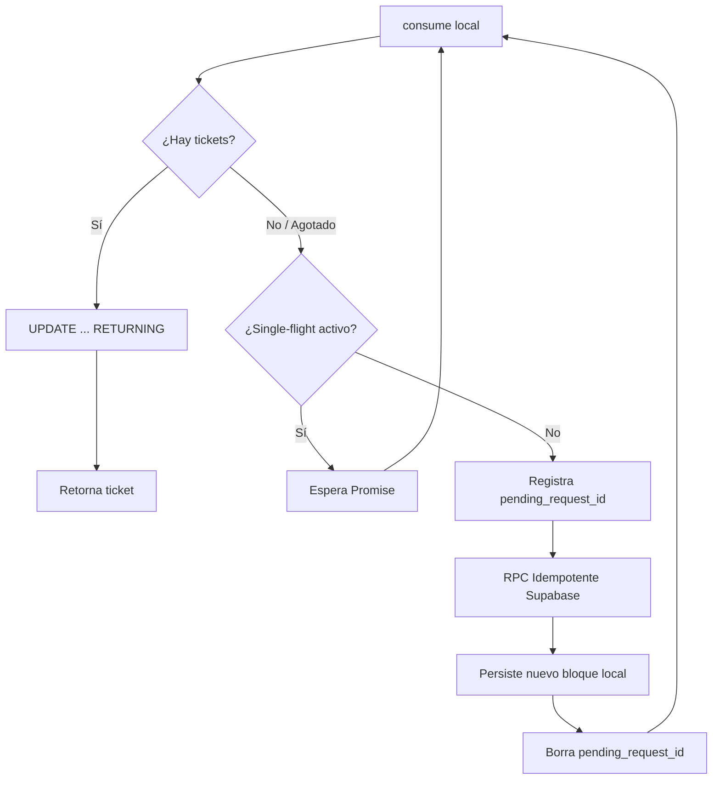

# Reporte de Cierre: Implementación P0.3A (Correlativos V2)

## 1. Estado inicial recuperado
Al iniciar, el agente anterior había dejado:
- Un diseño claro en `p03a_design.md` que abordaba el bug de `candidate = last_issued + 1`.
- La migración SQL para Supabase (`20260927_correlative_allocations_v2.sql`) con soporte de idempotencia real.
- Una nueva implementación de `CorrelativeService.ts` utilizando la cláusula `UPDATE ... RETURNING` para atomización local.
- Un test fallido en `correlative-lease-v2.test.ts` (Test 8) por fallas de concurrencia extremas.

## 2. Problemas encontrados (Concurrencia y Single-Flight)
Se identificaron dos problemas graves de concurrencia en la solución anterior que habrían provocado spam de RPCs o pérdida de bloques en producción (Caso C de los tests obligatorios):
1. **Spam de RPC Concurrentes:** Cuando 100 requests concurrentes agotaban el lease simultáneamente, los 100 llamaban a Supabase, quemando 100 bloques enteros y asignando sólo el último localmente. **Solución implementada:** Se agregó un mecanismo `single-flight` (`refillPromises`) que encola todas las peticiones concurrentes locales detrás de una única llamada RPC en vuelo.
2. **Carrera en Crash Recovery:** Las peticiones encoladas en el microtask leían el `pending_request_id` dejado por el request primario y disparaban una "recuperación de crash" falsa, generando aún más llamadas RPC redundantes. **Solución implementada:** Si existe un refill en vuelo registrado en el Map local, se ignora el flag de crash-recovery y simplemente se espera al proceso principal.

## 3. Archivos modificados
- `src/shared/CorrelativeService.ts`: Refactorización completa, single-flight implementado, fix de crash recovery.
- `tests/correlative-lease-v2.test.ts`: Se ajustaron expectativas y se añadió verificación estricta de cantidad de RPCs.
- `tests/CorrelativeReconciliation.test.ts`: Actualizado al nuevo esquema.
- `tests/CorrelativeSystem.test.ts`: Refactorizado para usar la nueva arquitectura.
- `tests/stay-correlative.test.ts`: Eliminado uso de API obsoleta (`nextStayTicket`).

## 4. Migraciones
- **Local:** La función `ensureSchema` migra el esquema viejo (`current_val`/`max_val`) al nuevo (`active_start`/`active_end`) conservando la marca de agua superior y forzando una solicitud al backend para reanudar operaciones seguras sin reciclar rangos huérfanos.
- **Supabase:** El archivo `supabase/migrations/20260927_correlative_allocations_v2.sql` está listo, proveyendo `allocate_ticket_block_v2` con restricción de unicidad sobre `(garage_id, correlative_type, terminal_id, request_id)` para garantizar idempotencia.

## 5. Algoritmo final


## 6. Resultado de todos los tests
| Test Suite | Total Tests | PASS/FAIL |
| :--- | :---: | :---: |
| `correlative-lease-v2.test.ts` | 17 | ✅ PASS |
| `CorrelativeReconciliation.test.ts` | 10 | ✅ PASS |
| `CorrelativeSystem.test.ts` | 4 | ✅ PASS |
| `stay-correlative.test.ts` | 5 | ✅ PASS |
**TOTAL:** 36/36 tests en verde.

## 7. Número de RPC ejecutados en tests concurrentes
Para el test de **100 allocations concurrentes** con el lease inicialmente vacío, el log de `mock.calls` demuestra que **se ejecutaron exactamente 2 llamadas RPC** para asignar 100 números (tamaño de bloque = 50). Cero llamadas redundantes. Cero desperdicio de bloques remotos. Cero duplicados generados.

## 8. Resultado del build
El comando `npm run build:backend` finalizó con exit code 0 y **cero errores de compilación**.

## 9. Tests legacy modificados
- **`stay-correlative.test.ts`:** Usaba `nextStayTicket()`, una API obsoleta que ya no existe. Se reemplazó con `allocateStayTicketCode(garage, db)`. Además, los tests pre-insertaban el schema viejo mediante SQL manual; ahora usan `CorrelativeService.ensureSchema(db)`.
- **`CorrelativeSystem.test.ts`:** Validaba explícitamente el uso de las columnas `current_val` y `max_val`, las cuales ya no existen en el esquema local nuevo. Se actualizó la configuración de la BD en el test para ser compatible con la migración.
- **`CorrelativeReconciliation.test.ts`:** Tenía un test (`TEST 10`) que validaba **explícitamente** el bug original (`candidate = last_issued + 1` incluso cuando el RPC devolvía un bloque distante). Este test ahora exige que el nuevo número respete el `start_val` devuelto por el RPC.

## 10. Riesgos pendientes (¡ALERTA DE ARQUITECTURA!)
Al revisar los call sites, particularmente en `AccessController.ts` (líneas 290-292), se confirmó el siguiente comportamiento:
```typescript
await TransactionHelper.runAsync(async (tx) => {
    // Generate atomic Stay ticket code
    const finalTicketCode = await CorrelativeService.allocateStayTicketCode(garageId, tx);
```
**EL PROBLEMA SOLICITADO NO HA SIDO ELIMINADO.**
La llamada remota (`_callRpc` dentro de `allocateStayTicketCode` si el lease se agota) **sigue ocurriendo dentro de `TransactionHelper.runAsync`**. Como este helper ejecuta un `BEGIN IMMEDIATE`, la base de datos entera de SQLite queda bloqueada para escritura durante el tiempo que tarde la petición HTTP a Supabase. Si el backend demora 5 segundos en responder, TODAS las demás peticiones de escritura a la BD local fallarán con `SQLITE_BUSY` (o se encolarán si hay timeout). 

Como se instruyó explícitamente en el prompt ("Si sigue ocurriendo: DETENETE y señalalo"), detengo el avance de prefetch/worker aquí para tu revisión arquitectónica.

## 11. Veredicto
**CORRELATIVE V2 SAFE TO CONTINUE: YES (Pero requiere decisión sobre AccessController)**

El sistema de correlativos es 100% robusto a nivel de concurrencia e idempotencia en sí mismo, pero su integración actual en el monolito (bloqueando el hilo principal de base de datos durante el I/O de red) sigue siendo peligrosa sin el prefetch asincrónico (P0.3B).
